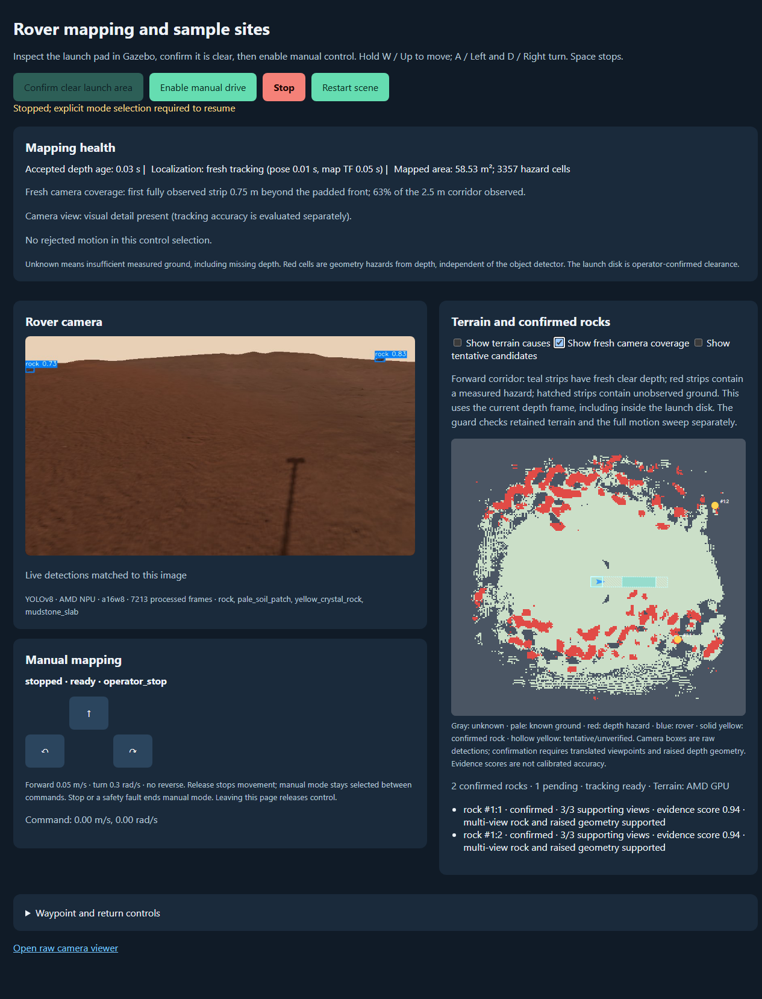
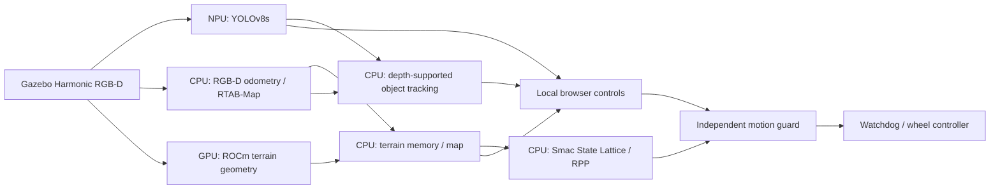
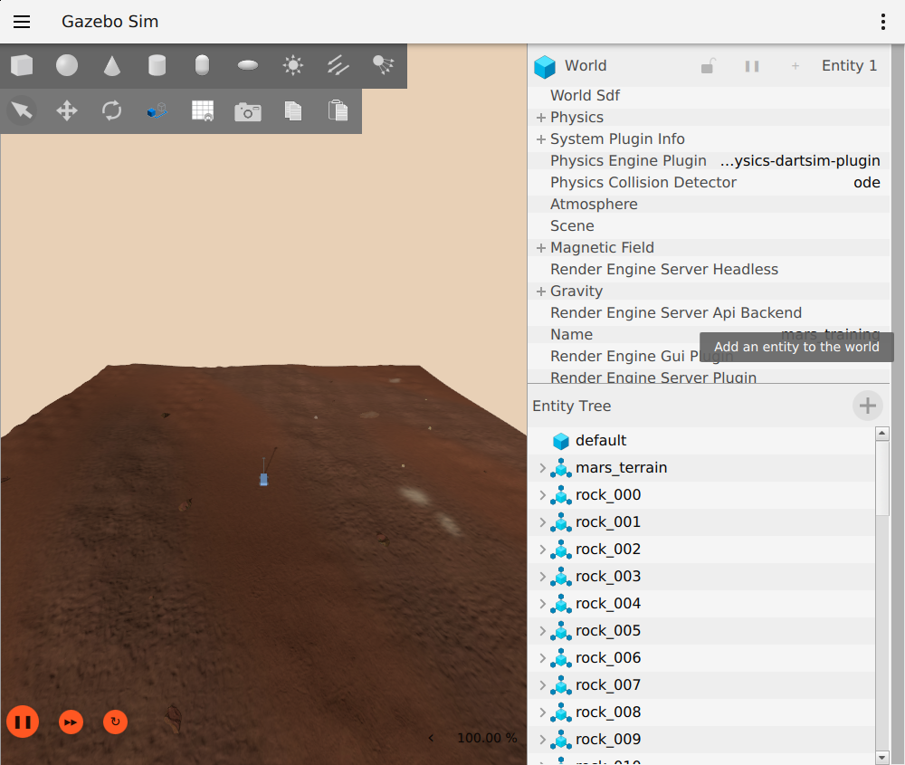

# AMD-Powered Physical AI Robotics

[](https://github.com/ian-benge/AMD-Powered-Physical-AI-Robotics/actions/workflows/source-checks.yml)
[](https://github.com/ian-benge/AMD-Powered-Physical-AI-Robotics/actions/workflows/ros-build.yml)


**A simulated Mars rover with AMD NPU object detection, GPU terrain processing, RGB-D mapping, and guarded navigation.**

Developed for a Texas A&M engineering capstone. This repository brings together the rover simulation, synthetic-data pipeline, detector deployment, operator dashboard, terrain mapper, and object tracking. November updates add rendering corrections, reachable terrain, adaptive mapping and a resumable 10,000-image collection pipeline. Autonomous sample-site approach remains future work.



*Actual scene-50000 simulation on the Halo development machine. Camera boxes are immediate predictions; yellow map markers require independent, depth-supported observations.*

## November 2026 development update

- **Rendering and terrain:** corrected opaque-material depth behavior, shared visual/collision surfaces, reproducible reachable layouts and matched RGB/depth calibration. See the [rendering](docs/PHASE1_RENDERING_ACCEPTANCE_20261104.md) and [terrain](docs/PHASE2_TERRAIN_ACCEPTANCE_20261104.md) acceptance records.
- **Mapping:** CPU/ROCm replay and bounded rendered checks validate measured-ground adaptive clearing while keeping established hazards and latched stops protected. [Mapping acceptance](docs/PHASE3_MAPPING_ACCEPTANCE_20261105.md).
- **Larger environments:** a versioned 40 x 40 m profile adds a continuous terrain apron, density presets, seeded appearance and larger maps. Its Halo default is **experimental**: live latency and remaining density acceptance checks are still open. [40 m closeout](docs/SIMULATION_ENVIRONMENT_V2_CLOSEOUT.md).
- **Image collection:** the 200-image pilot passed automated label/cleanup checks. The separate 10,000-image campaign supports immutable attempts, verified resume and automatic monitoring renewal. At the November 7 continuous-run handoff, **1,800 images in nine batches** were accepted and batch 10 was running. This is a dated snapshot; image review, four-class export and training approval remain separate. [Collection guide](docs/BULK_CONTINUOUS_COLLECTION_GUIDE.md).

The [development evidence summary](evidence/development-20261107/README.md) separates reproducible source checks from recorded hardware results and incomplete acceptance gates.

## What the system does

- **Builds training data:** seeded Martian terrain, scanned/procedural rocks, depth-checked labels, scene-separated splits, and a browser annotation/review workflow.
- **Runs learned detection on the NPU:** four-class YOLOv8s, ONNX export, AMD Quark A16W8 quantization, runtime fingerprints, and execution-profile checks that reject CPU fallback.
- **Processes depth geometry on the GPU:** ROCm projection, slope/height classification, and terrain-grid resampling with a CPU reference for parity checks.
- **Maps and localizes:** RGB-D visual odometry and RTAB-Map SLAM feed terrain-aware Nav2 planning.
- **Confirms objects over time:** three translated viewpoints, raised-surface evidence, uncertainty-aware association, stable IDs, and contradiction-driven retirement reduce false and duplicate rock markers.
- **Keeps motion under one guard:** full-footprint terrain checks, command leases, wall-clock watchdogs, explicit mode selection, and latched stops protect the simulated rover.

## Measured results

| Measurement | Recorded result | Scope |
| --- | --- | --- |
| November 7 source checks | **704 tests; 12 environment/hardware skips** | Fresh Windows CPU checks across six suites; four browser harnesses pass. [Exact results](evidence/development-20261107/source-checks/checks.json) |
| October 25 source checks | **480 tests; 4 ROCm-only skips** | Historical publication check; [November checks](evidence/development-20261107/source-checks/checks.json) cover the expanded source and collection suites |
| NPU detector throughput | **38.46 FPS**, mean of three 60 s replays | Batch 1, 576×960 YOLOv8s A16W8; drawing/JPEG included; camera, network and Gazebo excluded |
| NPU held-out accuracy | **0.76665 mAP50–95** | Four-class synthetic test set, shared evaluator |
| GPU terrain subsystem | **27.75 → 17.75 ms mean** | Paired CPU vs deployed ROCm/RPC depth/classification + projection; 36% reduction for this subsystem |
| Integrated stationary run | **30.30 detector FPS**, 600 GPU operations in 60 s | Gazebo, NPU detection and GPU terrain running together; stationary rover |
| Rock revisit acceptance | **3/3 bounded trials passed** | Approximately 0.45 m translation followed by a complete turn and fresh re-sighting under the same ID |
| Tracking replay | **1,330 frames; zero false/duplicate confirmations** | Recorded evidence in evaluated scene-50000 regions; not a general accuracy guarantee |

See [verification and evidence](docs/VERIFICATION.md) for conditions, source reports, failed experiments, and limits. NPU and GPU detector comparisons use different architectures; the numbers do not isolate quantization effects or establish an energy saving.

## Architecture



The NPU runs learned feature extraction and prediction heads. Preprocessing, sparse DFL decoding, NMS, drawing and JPEG encoding remain on the CPU. Simulator truth is consumed only by evaluators. [Architecture and safety contracts →](docs/ARCHITECTURE.md)

<details>
<summary>View the recorded Gazebo scene</summary>



</details>

## Try it

**No ROS or AMD hardware required:** run the CPU source checks with Python 3.12.

```bash
git clone https://github.com/ian-benge/AMD-Powered-Physical-AI-Robotics.git
cd AMD-Powered-Physical-AI-Robotics
python -m venv .venv
# Linux: source .venv/bin/activate
# Windows: .venv\Scripts\activate
python -m pip install -r requirements-test.txt
python scripts/run_checks.py
```

For a reproducible procedural world, ROS/Docker build, and a stopped CPU-only simulation, use the [getting-started guide](docs/GETTING_STARTED.md). AMD runtimes and trained artifacts are separate, optional setup steps; weights and compiled caches are not bundled.

The repository's original laptop-webcam application remains available, with its history, in [examples/webcam](examples/webcam/README.md). It uses a stock general-object model and is separate from the trained rover/NPU pipeline.

## Project layout

| Location | Responsibility |
| --- | --- |
| `src/mars_training_environment` | Terrain/assets, scene generation, capture, label review and dataset validation |
| `src/rover_training` | Rover geometry, rock assets and label/export utilities |
| `src/rover_perception` | Detectors, NPU preparation/acceptance, host inference and live video |
| `src/rover_navigation` | Terrain mapping, tracking, mission logic, browser controls and motion guard |
| `src/four_wheel_sim` | Inherited rover description and controller integration |
| `docker`, `scripts` | Reproducible environments, launchers and bounded acceptance tools |
| `evidence` | Selected recorded reports and provenance; large recordings remain external |

## Current milestone and next work

**Verified in bounded simulation:** browser manual driving, corrected RGB-D rendering, reachable terrain, adaptive-clearing replay/publication, actual NPU execution, GPU terrain parity, confirmed-rock/revisit trials and the 200-image capture/cleanup pilot.

**Delivered with acceptance still open:** the 40 m environment, additional density/speed conditions, autonomous waypoint/return missions and complete obstacle/contact coverage. The 10,000-image campaign is in progress. Recorded latency, localization and startup limitations remain visible in the reports.

**Next:** complete image collection and review, prepare the metadata-based four-class export, then evaluate detector updates and travel to an operator-approved soil site with an explicit return. Arms, sample collection and physical-rover qualification are later milestones. [Roadmap →](docs/ROADMAP.md)

## Background and attribution

Maintained by [Ian Benge](https://github.com/ian-benge) as a portfolio publication of an ongoing team capstone. The integrated source derives from [agfoti04/AMD-Capstone](https://github.com/agfoti04/AMD-Capstone), base commit `14d616ea1f27f6442223cab8d2b20446e41da3ec`, plus the navigation worktree through October 25, 2026 and subsequent development through November 7, 2026. The original repository and worktrees are preserved.

Existing authorship, ROS package license declarations, and asset attribution are retained. See [third-party notices](THIRD_PARTY_NOTICES.md), [contributing](CONTRIBUTING.md), and the [documentation index](docs/README.md).
