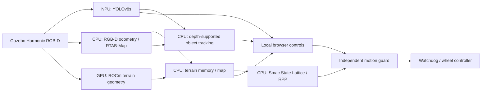

# AMD-Powered Physical AI Robotics

[](https://github.com/ian-benge/AMD-Powered-Physical-AI-Robotics/actions/workflows/source-checks.yml)
[](https://github.com/ian-benge/AMD-Powered-Physical-AI-Robotics/actions/workflows/ros-build.yml)


**A simulated Mars rover with AMD NPU object detection, GPU terrain processing, RGB-D mapping, and guarded navigation.**

Developed for a Texas A&M engineering capstone. The project combines a reproducible Mars environment, synthetic-data collection, four-class detector training, AMD accelerator deployment, terrain mapping and a browser-controlled rover. An autonomous exploration, simulated sampling and return workflow is implemented as an experimental candidate; end-to-end acceptance remains open.

**For AMD evaluation:** start with the [testing guide](docs/AMD_TESTING_GUIDE.md), which separates clean-checkout tests, retained Halo deployment requirements, measured results and unresolved issues. This is a simulation research prototype; no physical-rover or completed autonomous-mission claim is made.


*Actual scene-50000 simulation on the Halo development machine. Camera boxes are immediate predictions; yellow map markers require independent, depth-supported observations.*

## Current status — November 11, 2026

- **Rendering and terrain:** corrected opaque-material depth behavior, shared visual/collision surfaces, reproducible reachable layouts and matched RGB/depth calibration. See the [rendering](docs/PHASE1_RENDERING_ACCEPTANCE_20261104.md) and [terrain](docs/PHASE2_TERRAIN_ACCEPTANCE_20261104.md) acceptance records.
- **Mapping:** CPU/ROCm replay and bounded rendered checks validate measured-ground adaptive clearing while keeping established hazards and latched stops protected. [Mapping acceptance](docs/PHASE3_MAPPING_ACCEPTANCE_20261105.md).
- **Larger environments:** a versioned 40 x 40 m profile adds a continuous terrain apron, density presets, seeded appearance and larger maps. Its Halo default is **experimental**: live latency and remaining density acceptance checks are still open. [40 m closeout](docs/SIMULATION_ENVIRONMENT_V2_CLOSEOUT.md).
- **Data and training:** collection was intentionally stopped at **5,000 images / 250 scenes**, including 1,000 background frames. A separate four-class export contains 5,300 training, 100 validation and 100 test images. Training stopped after 28 saved epochs; the validation-selected epoch-22 checkpoint is the assessment candidate. Complete new-image visual review remains outstanding. [Dataset preparation](docs/CAPTURE5000_TRAINING_READINESS_20261108.md).
- **Detector evaluation:** matched NPU test mAP50–95 improved from **76.67% to 78.90%** on the same 100 legacy test images. Mudstone AP decreased, and unseen 40 m scene evaluation remains pending. The baseline stays available. [Model comparison](docs/CAPTURE5000_MODEL_ASSESSMENT.md).
- **Autonomous demo:** exploration, return reservation, target preview/approval, simulated collection, route layers and browser-loss stops are implemented with replay and ROS interface checks. The first autonomous return was interrupted by a host freeze; its cause is unresolved. **No complete autonomous cycle has passed acceptance.** [Demo guide](docs/AUTONOMOUS_DEMO_GUIDE.md), [incident report](docs/AUTONOMOUS_DEMO_FREEZE_20261110.md).
- **Thermal isolation:** the GUI-off browser candidate retains 15 Hz Ogre RGB-D, NPU detection and float64 GPU terrain. A five-minute stationary interval recorded **80.82°C mean / 83.125°C peak**, worst reported rolling mapping p95 **165.65 ms**, and median reported real-time factor **0.996**. The below-80°C target was not met; no matched cooling or endurance claim is made. [Plots and scope](docs/AUTONOMOUS_DEMO_BROWSER_PROFILE.md).

The [AMD handoff evidence](evidence/amd-testing-20261111/README.md) and [earlier development evidence](evidence/development-20261107/README.md) separate fresh source checks from recorded hardware measurements. Raw datasets, model weights, compiled caches and private operator kits are not included in Git.

## What the system does

- **Builds training data:** seeded Martian terrain, scanned/procedural rocks, depth-checked labels, scene-separated splits, and a browser annotation/review workflow.
- **Runs learned detection on the NPU:** four-class YOLOv8s, ONNX export, AMD Quark A16W8 quantization, runtime fingerprints, and execution-profile checks that reject CPU fallback.
- **Processes depth geometry on the GPU:** ROCm projection, slope/height classification, and terrain-grid resampling with a CPU reference for parity checks.
- **Maps and localizes:** RGB-D visual odometry and RTAB-Map SLAM feed terrain-aware Nav2 planning.
- **Confirms objects over time:** three translated viewpoints, raised-surface evidence, uncertainty-aware association, stable IDs, and contradiction-driven retirement reduce false and duplicate rock markers.
- **Keeps motion under one guard:** full-footprint terrain checks, command leases, wall-clock watchdogs, explicit mode selection, and latched stops protect the simulated rover.
- **Implements a bounded mission candidate:** information-gain frontier selection, return budgeting, detected-soil or map-click target selection, approved round trips and ten-second simulated collection. Acceptance gates remain explicit.

## Measured results

| Measurement | Recorded result | Scope |
| --- | --- | --- |
| Current source checks | **805 tests; 16 hardware/OS skips** | Six isolated Python suites and six browser JavaScript harnesses; [fresh results](evidence/amd-testing-20261111/source-checks/checks.json) |
| Epoch-22 NPU held-out accuracy | **78.90% mAP50–95**; baseline **76.67%** | Same 100 legacy synthetic test images and shared deployment evaluator; not an unseen 40 m or physical-camera test |
| Epoch-22 NPU execution | **23.46 ms mean / 24.22 ms p95** | 100 test images, 576×960 A16W8; model execution only, excluding rendering, transport and drawing |
| Historical baseline NPU throughput | **38.46 FPS**, mean of three 60 s replays | Batch 1, 576×960 YOLOv8s A16W8; drawing/JPEG included; camera, network and Gazebo excluded |
| GPU terrain subsystem | **27.75 → 17.75 ms mean** | Paired CPU vs deployed ROCm/RPC depth/classification + projection; 36% reduction for this subsystem |
| Historical integrated stationary run | **30.30 detector FPS**, 600 GPU operations in 60 s | Earlier Gazebo/NPU/GPU profile; stationary rover; separate from the current 15 Hz browser measurements |
| Rock revisit acceptance | **3/3 bounded trials passed** | Approximately 0.45 m translation followed by a complete turn and fresh re-sighting under the same ID |
| Tracking replay | **1,330 frames; zero false/duplicate confirmations** | Recorded evidence in evaluated scene-50000 regions; not a general accuracy guarantee |
| GUI-off stationary mapping | **165.65 ms worst reported rolling p95; 83.125°C peak Tctl** | Five steady minutes, stopped rover, sparse 40 m scene; no matched baseline, autonomous or endurance acceptance |

See [verification and evidence](docs/VERIFICATION.md) for conditions, source reports, failed experiments, and limits. NPU and GPU detector comparisons use different architectures; the numbers do not isolate quantization effects or establish an energy saving.

## Architecture



The NPU runs learned feature extraction and prediction heads. Preprocessing, sparse DFL decoding, NMS, drawing and JPEG encoding remain on the CPU. Simulator truth is consumed only by evaluators. [Architecture and safety contracts →](docs/ARCHITECTURE.md)

<details>
<summary>View the recorded Gazebo scene</summary>


</details>

## Try it

**No ROS or AMD hardware required:** run the CPU source checks with Python 3.12.

```bash
git clone https://github.com/ian-benge/AMD-Powered-Physical-AI-Robotics.git
cd AMD-Powered-Physical-AI-Robotics
python -m venv .venv
# Linux: source .venv/bin/activate
# Windows: .venv\Scripts\activate
python -m pip install -r requirements-test.txt
python scripts/run_checks.py
```

For a reproducible procedural world, ROS/Docker build, and a stopped CPU-only simulation, use the [getting-started guide](docs/GETTING_STARTED.md). AMD runtimes and trained artifacts are separate, optional setup steps; weights and compiled caches are not bundled.

The repository's original laptop-webcam application remains available, with its history, in [examples/webcam](examples/webcam/README.md). It uses a stock general-object model and is separate from the trained rover/NPU pipeline.

## Project layout

| Location | Responsibility |
| --- | --- |
| `src/mars_training_environment` | Terrain/assets, scene generation, capture, label review and dataset validation |
| `src/rover_training` | Rover geometry, rock assets and label/export utilities |
| `src/rover_perception` | Detectors, NPU preparation/acceptance, host inference and live video |
| `src/rover_navigation` | Terrain mapping, tracking, mission logic, browser controls and motion guard |
| `src/four_wheel_sim` | Inherited rover description and controller integration |
| `docker`, `scripts` | Reproducible environments, launchers and bounded acceptance tools |
| `evidence` | Selected recorded reports and provenance; large recordings remain external |

## Current milestone and next work

**Verified in bounded simulation:** browser manual driving, corrected RGB-D rendering, reachable terrain, adaptive-clearing replay/publication, actual NPU execution, GPU terrain parity, confirmed-rock/revisit trials and the 200-image capture/cleanup pilot.

**Delivered with acceptance still open:** the 40 m environment across all density/speed conditions, the epoch-22 detector on unseen scenes, autonomous exploration/sampling/return, and complete obstacle/contact coverage. The 10,000-image reservation stopped at 5,000; it is not a completed dataset.

**Next:** investigate host stability and startup odometry, establish thermal margin, complete diagnostic image review, then qualify fresh autonomous cycles and recording. Sampling in this candidate is a timed stationary event and record; physical collection hardware remains future work. [Roadmap →](docs/ROADMAP.md)

## Background and attribution

Maintained by [Ian Benge](https://github.com/ian-benge) as a portfolio publication of an ongoing team capstone. The integrated source derives from [agfoti04/AMD-Capstone](https://github.com/agfoti04/AMD-Capstone), base commit `14d616ea1f27f6442223cab8d2b20446e41da3ec`, plus the navigation worktree through October 25, 2026 and subsequent development through November 10, 2026. The original repository and worktrees are preserved. This is an independent student project, not an AMD product or endorsement.

Existing authorship, ROS package license declarations, and asset attribution are retained. See [third-party notices](THIRD_PARTY_NOTICES.md), [contributing](CONTRIBUTING.md), and the [documentation index](docs/README.md).
