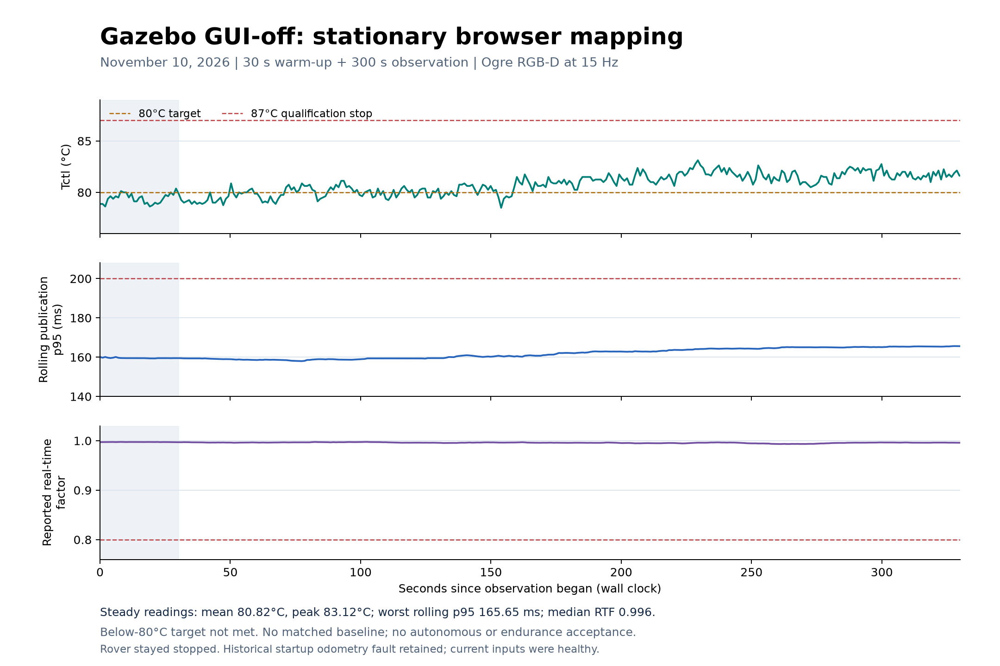

# Browser profile with the Gazebo window disabled

This separate experimental demo profile sets `gui:=false` and `rviz:=false`.
Gazebo runs its physics and sensor server with `-s`; Ogre RGB-D still uses the
connected graphical desktop. The renderer, 960 × 540 images, 15 Hz RGB-D,
20 m RGB / 8 m usable depth, 40 m maps, epoch-22 NPU model, CPU/thread limits,
float64/HIP flags 4, power/fan policy and motion safeguards are retained.

The change removes the additional Gazebo GUI scene from normal browser operation.
The November 10 stationary check completed with a mean Tctl of 80.82°C and a
peak of 83.125°C. The below-80°C target was not met. There is no matched GUI-on
measurement, so a causal temperature reduction is not established; the earlier
host freeze remains unresolved.
Restart and Generate new scene retain the GUI-disabled profile and fresh maps.
The previous `application-v11` / `runtime-v11` remain separate rollback artifacts.

## Stationary exterior inspection

The checked runtime includes `view_autonomous_demo.sh`. Run it from another Halo
desktop terminal after the browser camera and renderer are ready:

```bash
bash /home/ian/capstone-training/rover-navigation/navigation_sessions/autonomous-demo-20261109/runtime-v15/view_autonomous_demo.sh 60
```

It attaches the existing Gazebo GUI to the same running world for at most sixty
seconds; the allowed duration is 5–90 seconds. This adds no simulator camera.
The rover must remain stopped and disarmed, with no active navigation goal and
a fresh browser camera. Inspect the launch area, close the view or let it time
out, then confirm clearance in the browser. Leave the rover stopped for thermal
checks. Driving footage with the exterior window open needs separate qualification.

The viewer retains the native guard and early 87°C stop. It stops its own GUI
worker if the stationary/fresh-camera requirements fail, the scene changes,
the operator interrupts or the timer expires. A historical motion-fault latch
does not prohibit stopped visual inspection; the viewer never clears that
fault, selects a drive mode or sends motion. Cleanup uses
a separate inherited GUI token, UID/start-time checks and pidfds, including
detached children. It does not clean up by Gazebo's shared partition, which also
contains the running sensor server. A lock allows one inspection viewer at a time.

Keep the desktop/RDP connection and visible temperature monitor active even when
the Gazebo window is closed. Windowless sensor operation is not a software-rendering
or unattended fallback.

## Verification and rollout

The sibling candidate reuses the byte-identical installed ROS build. Its release
pins bind the new source snapshot, GUI wrapper, bounded viewer and all retained
files. The deployment checks exercise viewer cleanup with a real detached CPU
child, preserve an unrelated same-partition process, verify restart/generation
settings, exercise the real ROS/HTTP interface and 15 Hz transport, and construct
all three scene launch graphs without starting rendering. Actual launch arguments
must contain `-s`, `--render-engine-server ogre`, and no `--headless-rendering`.

The installed application is `application-v13`; the corrected host frontend is
`runtime-v15`. Eight initial tool/viewer tests, thirteen scene-control tests,
the real ROS/HTTP probe, 90/90 RGB and depth transport messages at approximately
15 Hz, and sparse/standard/cluttered launch graphs passed. Five final frontend
lifecycle/command tests passed using system Python. The 403 retained installed
ROS files were byte-identical to v11; the complete source suite was not rerun.

The actual eight-second viewer check and the operator's subsequent sixty-second
inspection both exited successfully with no cleanup errors. Process inspection
confirmed the sensor server used `-r -s --render-engine-server ogre`, with no
Gazebo GUI or RViz after inspection. The host launches the viewer worker with
the retained ROS and installation environment explicitly sourced.

Live verification requires fresh native capture/temperatures, current-session NPU
qualification and float64/HIP4 terrain parity. Run a stationary measurement after
the inspection window closes. Record actual temperature, package power, sensor
ages, mapping p95 and real-time factor. The goal is sustained temperature below
80°C while retaining p95 ≤200 ms and all freshness rules; this is a proposed target,
not an acceptance result. Preserve the original 87°C qualification / 90°C native
limits and all failures.

A bounded, read-only off-host observer saves native journal/health records and
GET-only rover status to Windows, flushing each received chunk to disk. It sends
no controls or browser heartbeats. It improves evidence retention but cannot
guarantee a kernel prints the cause of a hard lockup before becoming unresponsive.
The original missing teardown and unresolved freeze remain documented in the
[incident report](AUTONOMOUS_DEMO_FREEZE_20261110.md).

Deployment status and remaining gates are summarized in the
[AMD testing guide](AMD_TESTING_GUIDE.md). A source change alone is not a
successful thermal test or autonomous demo acceptance.

## November 10 stationary results



The steady observation was **22:09:41.533–22:14:41.533 UTC**, following thirty
seconds of warm-up. The rover remained stopped/disarmed with zero commands,
no navigation goal and no recorded travel. The sparse 40 m scene, epoch-22
detector and float64/HIP4 terrain service remained active.

| Measurement | Observed result |
|---|---|
| Tctl, steady status readings | Mean 80.82°C; median 80.875°C; range 78.5–83.125°C |
| Rolling depth-to-map publication p95 | 158.00–165.65 ms; all observations below 200 ms |
| Reported real-time factor | Median 0.996; minimum 0.993 |
| Largest accepted-depth / estimated-pose age | 0.152 s / 0.075 s |
| Largest browser camera age | 0.545 s |
| Native PPT telemetry | Mean 70.43 W; range 68.00–74.03 W |
| Available host memory | Minimum 49.78 GiB |
| Protection | 87°C qualification / 90°C native limits unchanged; no trip |
| Sustained temperature below 80°C | **Not met** |

The plotted p95 and RTF are the application's reported rolling statistics,
not a newly measured matched-baseline benchmark. Native telemetry supplied 58
health snapshots during the steady interval; the gateway supplied 299 steady
status observations. The CSV and exportable [SVG](figures/demo-gui-off-20261110/stationary-gui-off.svg)
and [PDF](figures/demo-gui-off-20261110/stationary-gui-off.pdf) accompany the figure.
Regenerate it with `scripts/plot_demo_gui_off_thermal.py` and
`docs/figures/demo-gui-off-20261110/readings.csv` using CPU Matplotlib.

An initial odometry message at simulation time 0.026 s carried uninitialized
covariance and latched `invalid_odometry` before mapping. Later inputs were
healthy; the original latch was preserved throughout. This was a stopped
thermal/timing observation, **not an accepted mission or localization-drift
qualification**. No movement, exterior-view driving load, 0.10 m/s test,
matched 20 m baseline or endurance result is claimed.

Two read-only observers overlapped before the first one's bounded timer ended.
The original single-input measurement consequently reported a late logging-gap
failure; that result is retained. Independent analysis switches streams at
22:14:30 UTC and verifies the full interval with a maximum 1.014 s status gap.
Hashed complete-line input snapshots preserve the handoff without editing either
raw log. The observers sent neither commands nor browser heartbeats.

Failures retained include the v12 launch-check helper's string/substitution bug,
v14's missing ROS environment in `docker exec`, an unsuitable SDK interpreter
without pidfd support, and a quoting error in a preflight-only probe. The corrected
frontend passed real container and viewer checks. Viewer stderr warnings about
DRM file-description comparison and an SDF extension remain in the archive;
the protected final kernel review reported no incident matches.

The operator completed the native cooldown/final journal capture at **22:17:16
UTC**. `MANUAL_SESSION_FINAL.json` reports `MANUAL_SESSION_CLOSED_CLEANLY` with
`post_teardown_clean=true`. The generic post-teardown experiment result remains
`INCOMPLETE_OR_FAILED_REVIEW_REQUIRED` because no timed experiment was accepted.
The original freeze's missing teardown remains a separate historical gap.

## Release and evidence identities

| Artifact | SHA-256 |
|---|---|
| `source-v13.tar.gz` | `1441bc1735cf0af3c91f989128cc0f0053f22bcc5060b9962a4f137a2e285266` |
| Application-v13 configuration | `72945c6701adb730e22f95f477430bf4f0c54fb687e24d319ade1598bbce9044` |
| Runtime-v15 release | `0017414bee09e4d2d0199d75609f246820cba9d2a58d05dc7c3896a0f7faaac5` |
| Corrected runtime-v15 viewer host | `9de6e437d1cb46e8b3860a3264d3b7dfbf2975ece76154af43fb7140aaaba94f` |
| Epoch-22 checkpoint | `90fca4a3e4fa702f213c044e7ac09fb0271a4e70d6b71ca670d7e0913da1793f` |
| Qualified Ogre plugin | `f6e8842247198a2b34b25cfdb40a8f4bc4f156c2e90a54135a68698dc239a3e6` |

The original v13 source archive contains the earlier viewer host. Use the checked
v15 frontend alongside application-v13; both versions and their compatibility
receipt are retained rather than rewriting the archive or installed ROS build.

Private evidence is under
`navigation_sessions/autonomous-demo-20261109/gui-off-20261110/`.
`GUI_OFF_HALO_EVIDENCE_V1.zip` was downloaded and **all 183 member hashes verified**
on Windows; archive SHA-256:
`b95d733831ef67c5d320c19b5285df38bb4934fc14a6dbe7c2b14e2e38f81960`.
It includes native protected review/finish, parity inputs and outputs, build and
viewer failures, corrected frontend, live configuration/process receipt and plots.
`GUI_OFF_EVIDENCE_V1.zip` adds the complete Windows observer logs, the preserved
single-input failure, reconciled analysis and hashed input snapshots. Its manifest,
identity and verification receipt remain beside the private archive. These archives
are omitted from Git; the measured CSV and figures are available with this guide.
